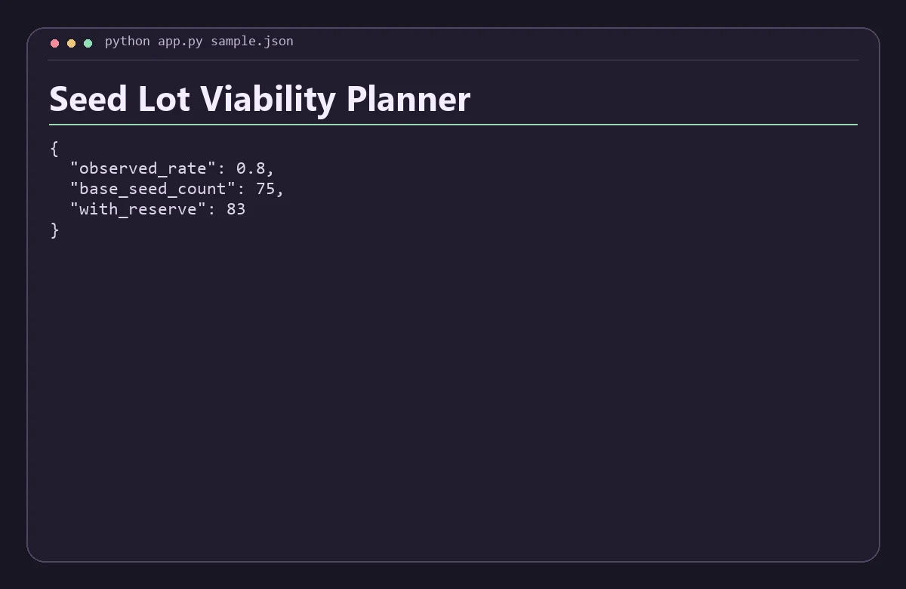

# Seed Lot Viability Planner

Translate a small garden germination test into a seed count based on your target and observed germination rate.



## Run

Install Python 3.11 or newer. Run these commands from the repository root.

```sh
python app.py sample.json
```

Replace `sample.json` with a JSON file following the same structure. The app prints a JSON report to standard output.

Provide positive test and target counts. Reserve is a percent added after finding the base seed count. Counts round up. This is an estimate from the sample.

## Verify

Run `python check.py` with Python 3.11 or newer after the build step when applicable. The check verifies the bundled scenario and confirms that an invalid input returns an error.
